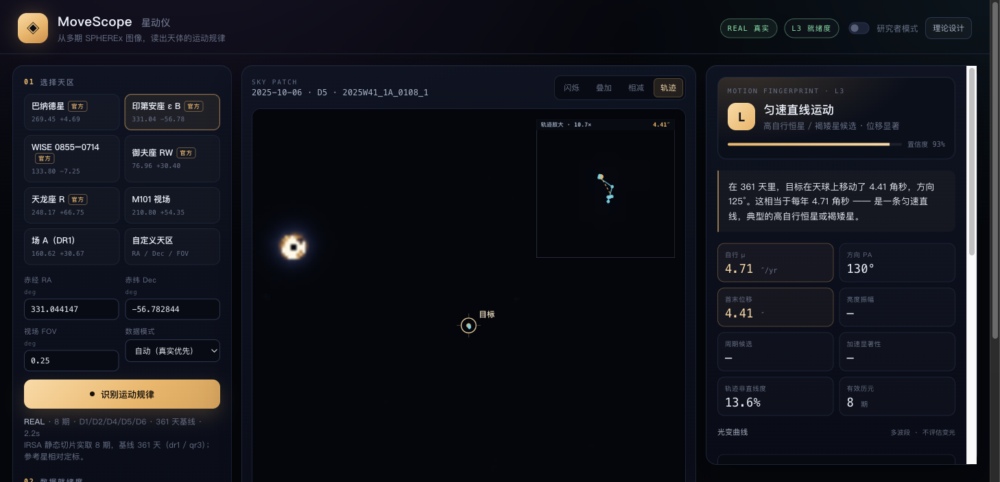

# MoveScope · 星动仪

**多期 SPHEREx 图像的天体运动 / 变光识别工具。**
输入一个天区坐标，MoveScope 取回多期 SPHEREx level-2 光谱像，测量目标及视场内
源的位置序列与亮度序列，拟合一组物理模型，最后输出**运动指纹**、规律判定、
置信度、证据链、可证伪条件，以及数据能支持到什么程度的边界。

[English](README.md) | **中文**

> 理论先于代码：先读
> [`系统/docs/01_理论设计编排.md`](系统/docs/01_理论设计编排.md)；
> 实现细节、实测值与偏差记录在
> [`系统/docs/02_实现与实测记录.md`](系统/docs/02_实现与实测记录.md)。



*真实数据：印第安座 ε B（Epsilon Indi B），8 期 SPHEREx 切片、361 天基线；
轨迹放大窗显示 4.41″ 的位移。*

---

## 1. 它做什么

MoveScope 是候选审查工具，不是发现引擎。对目标输出以下运动类别之一：

| 类别 | 含义 | 常见解释 |
|---|---|---|
| **L** | 匀速直线运动 | 近邻恒星 / 褐矮星的高自行 |
| **V** | 变光 | 位置不动、亮度变化（变星、AGN） |
| **A** | 加速 / 弯曲 | 太阳系天体或双星轨道候选 |
| **S** | 静止 | 背景恒星 / 星系，给出 3σ 运动上限 |
| **U** | 不可判定 | 数据就绪度或质量不足；不猜 |

每个结果带：

- **数据就绪度** L0–L3（1 / 2 / 3–5 / ≥6 期且基线 ≥6 个月）；
- **模型选择**：M0 静止、M1 变光、M2 匀速、M3 视差、M4 自行+加速；
- **证据链**与**可证伪条件**；
- **数据来源标识** REAL / HYBRID / SIM / SAMPLE；模拟数据不伪装成真实观测；
- 明确的 `discovery_claim: false` 边界。

工具只陈述“候选”和“证据”。“没有星表匹配”只表示“未收录候选”，
绝不写成“新恒星/新行星”。

---

## 2. 当前状态

app 测试套件当前为 **286 项**：

```bash
PY=/Users/yiao/.dsh/dsh-runtimes/dsh-primary-runtime/dependencies/python/bin/python3
cd 系统/app
$PY -m unittest discover -s tests
# Ran 286 tests ... OK
```

近期完成的能力：

- 主画布模式：**普通 / 级联-残差 / 轨迹**；
- `t0/t1` 分析时间窗口与层数据过滤；
- A 源 / C 源批量星表识别；
- CSV/JSON 审计导出，CSV 支持候选展开；
- Gaia + 2MASS + WISE 多目录批量消费，0.5″ 位置去重；
- 星表先验 motion（Barnard 类短基线场景）；
- A + C + Tracks 统一候选目录；
- 不写生产星表 DB 的只读批量/候选审查链路。

当前缓存下的 5 个官方案例：

| 目标 | 官方预期 | App 结果 | 说明 |
|---|---|---|---|
| Barnard's Star | L | **L（catalog prior）** | SPHEREx 未独立测出；使用 Gaia PM 先验 |
| Epsilon Indi B | L + O | **L**，身份 ambiguous | RUWE 高；不强行给单目录身份 |
| WISE 0855 | L | **U** | 数据受限；不强行判 L |
| RW Aurigae | V | **V** | 位置稳定、流量变化 |
| R Draconis | V | **V** | 位置稳定、流量变化 |

结果：**4 PASS + 1 DATA_LIMITED**。允许失败或数据受限，不按预期答案调标签。

---

## 3. 快速开始

### 依赖

- Python 3.12 + NumPy + Pillow（仓库自带运行时可开箱使用）；
- 支持 Canvas 的浏览器；
- 可选 3D 视图需要 WebGL2；
- 默认全部只监听本机端口。

### 一条命令（DB + app + view）

```bash
cd /Users/yiao/Documents/huellaX
项目主控/启动/start_all.sh
# 打开 http://127.0.0.1:8790/
```

启动器会做健康检查；已有服务不会静默替换。详见
[`项目主控/启动/README.md`](项目主控/启动/README.md)。

### 手动启动

```bash
PY=/Users/yiao/.dsh/dsh-runtimes/dsh-primary-runtime/dependencies/python/bin/python3

# 1) 主 app
$PY 系统/app/server.py --port 8790

# 2) 可选：SQLite/Blob 数据服务（任意坐标 DB 查询需要）
cd 系统/数据库工具
$PY cli.py serve --port 8797
```

可选伴侣服务：

```bash
# B：星表 / 识别服务（8799）
cd 系统/数据库工具
$PY tools/import_gaia.py --rebuild --offline
$PY catalog_server.py --port 8799

# C：本地覆盖 / 发现 / 取数（8798）
cd 系统/anyfield
./start.sh 8798

# View：three.js 天区/地球选择器（8830）
cd 系统/视图工具
./start.sh 8830
```

主页面：<http://127.0.0.1:8790/>。
B/C 未启动时 app 会明确降级，不伪造星表或覆盖结果。

### 常用 URL

```text
http://127.0.0.1:8790/                                      # 普通模式
http://127.0.0.1:8790/?target=barnard                      # 预设目标
http://127.0.0.1:8790/?ra=269.452077&dec=4.693365&fov=0.2  # 自定义坐标
http://127.0.0.1:8790/?target=barnard&mode=cascade          # 主画布级联层
http://127.0.0.1:8790/?target=barnard&mode=tracks
http://127.0.0.1:8790/?ra=269.452077&dec=4.693365&fov=0.5&t0=60890&t1=60950&from=view
```

`mode` 是**画布模式**（`browse` / `cascade` / `tracks`），不是数据模式。
数据模式在左栏选择（`auto` / `real` / `synthetic` / `sample`）。
`/cascade`、`/tracks` 保留为详细诊断页；主界面切模式不会跳页。

---

## 4. 架构

```text
                         ┌─────────────────────────────┐
                         │ View（可选，8830）           │
                         │ 天区/地球选择器              │
                         │ ra / dec / fov / t0 / t1    │
                         └──────────────┬──────────────┘
                                        │ 一次 handoff URL
                                        ▼
┌──────────────────────────────────────────────────────────────────┐
│ MoveScope app（8790）                                            │
│                                                                  │
│  浏览器 UI（无构建步骤）                                          │
│    普通   ── 分析、源点选、锁定、单源识别                          │
│    级联   ── L1 / masked / residual 叠加                          │
│    轨迹   ── tracklet 线/节点与 D0–D4 层级                        │
│                                                                  │
│  /api/analyze   → build_dataset → pipeline → result              │
│  /api/cascade   → 每期 L1 / mask / residual                       │
│  /api/tracks    → tracklet → D0–D4                               │
│  /api/identify  → B 单源星表匹配                                 │
│  /api/identify/batch → A/C 批量星表匹配                          │
│  /api/identify/batch/export → CSV/JSON attachment                 │
└───────────────┬───────────────────────┬──────────────────────────┘
                │                       │
                ▼                       ▼
┌───────────────────────────┐   ┌──────────────────────────────────┐
│ DB 服务（8797）           │   │ B 星表服务（8799）               │
│ SQLite 元数据 + Blob      │   │ Gaia DR3 + 派生 2MASS/WISE        │
│ 历元/覆盖索引             │   │ 单源/批量 match，可选 TAP ingest  │
└───────────────────────────┘   └──────────────────────────────────┘
                │
                ▼
┌───────────────────────────┐
│ C 覆盖服务（8798）        │
│ 本地 ingest / 发现        │
│ S3/IRSA cutout 取数       │
└───────────────────────────┘
```

主 app 无构建步骤，`web/` 静态资源直接由 HTTP 服务提供。
核心分析只需要 Python + NumPy + Pillow，不依赖 Astropy/SciPy/FastAPI。

### 分析流水线

```text
FITS / level-2 图像
  → 背景 + FLAGS 掩膜 + 噪声模型
  → 匹配滤波探测
  → PSF / saturated bloom 质心 + 孔径测光
  → 参考星相对天体测量定标
  → 跨历元位置关联
  → 拟合 M0/M1/M2/M3/M4 模型族
  → BIC 模型选择 + 3σ / 就绪度门限
  → result / evidence / falsifier / provenance
```

核心模块：

- `系统/app/core/photometry.py` — 掩膜、匹配滤波、质心、测光；
- `系统/app/core/motion.py` — 模型族、BIC、运动指纹；
- `系统/app/core/pipeline.py` — 探测 → 定标 → 关联 → 推断；
- `系统/app/core/catalog.py` — B 客户端、状态映射、多目录去重、可选 ingest；
- `系统/app/core/catalog_prior.py` — 通用 Gaia PM 先验；
- `系统/app/core/tracks.py` — 跨历元 tracklet 与 D0–D4。

### 时间窗口

`/api/analyze`、`/api/cascade`、`/api/tracks` 接受 `t0` / `t1`
（也接受 `mjd_min` / `mjd_max`）。在 `data_layer.build_dataset` 之后过滤：

- 0 期 → HTTP 200 + 明确空窗口结果，绝不伪造测量；
- 1 期 → 单期结果；tracks 标 `insufficient`；
- 无 `t0/t1` → 旧行为不变。

响应带 `time_filter: {t0,t1,requested,kept,filtered}`；
UI 显示“来自视图 / 时间窗口 / 保留 N/M 期”。

---

## 5. 主界面模式

### 普通

原有行为：多期闪烁 / 叠加 / 相减 / 轨迹，A 源表，锁定与单源识别，
就绪度与模型证据。

### 级联 / 残差

每期：

- **L1**：6σ 检测，每期最多 80 个；
- **masked**：L1 位置，2 px 掩膜，`reason=already_detected`；
- **residual**：局部中值掩膜后 5σ 复检，每期最多 80 个，排除离 L1 中心 2 px 内重复。

主画布：L1 实心青点、masked 灰叉、residual 空心琥珀圈。
支持图层开关、当前帧计数。点击 residual 节点会锁定并调用
`/api/identify`，不会重新跑完整分析。残差候选明确**不是新天体**。

详细诊断页：[`/cascade`](系统/app/web/cascade.html)。

### 轨迹

L1 + residual 节点跨历元关联（贪心最近邻、3 px 门限、允许缺 1 期、节点不复用）。
模型：`stationary / linear / curved / variable / transient`；层级：

- D0 artifact；
- D1 known catalog；
- D2 未实现；
- D3 unknown moving；
- D4 unknown stationary；
- D5 out of scope（人工/后续确认）。

主画布画轨迹线与节点；点击节点跳到对应历元并调用 `/api/identify`。
轨迹候选**不是新天体**；4 期关联本身有歧义，每条 track 都带 caveat。

详细诊断页：[`/tracks`](系统/app/web/tracks.html)。

### A / C 源表批量识别

- A 表：分析 `sources`，每批 200；
- C 表：`/api/sources` 行，每批 200；
- 每个源送 `/api/identify/batch`；
- 状态：known / ambiguous / no_match（`uncatalogued_candidate`）/
  insufficient / catalog unavailable / unknown；
- A/C 批量 note 显示计数与请求目录；
- 批量结果可审计导出，不改变表格。

### 统一候选目录

A + C + Tracks 合并为只读审计表：

- A/C 行按 `(mjd, round(ra,6), round(dec,6))` 去重；
- 同位置 A/C 合并 `origins="A;C"`；
- 身份冲突保留 `conflict`，不静默选一个；
- 一 track 一行；track 节点**不另算源**；
- counts：rows / unique_sources / tracks / known / ambiguous / no_match /
  insufficient / unknown / conflict；
- CSV/JSON 导出；UI 显示前 80 行，计数为全量。

---

## 6. 星表识别与多目录规则

### 状态语义

| 状态 | 含义 |
|---|---|
| `known_star` | 单候选且天体测量质量可接受 |
| `ambiguous` | 多个物理候选，或 RUWE/PM/质量冲突 |
| `uncatalogued_candidate` | 查询成功但 0 候选；**不是**“新天体” |
| `insufficient_data` | 信息不足；例如单候选偏离 >6.15″ |
| `catalog_unavailable` | 星表服务/覆盖不可用；**不是**“未匹配” |

单候选偏离目标超过 **6.15″**（1 个 SPHEREx 像素）会判为
`insufficient_data`，reason `CATALOG_OFFSET_TOO_LARGE`，不当作偶然对齐的 known。

### 星表先验 motion

短基线 `class="S"` 结果在满足以下条件时可加通用星表先验：

- 单候选/ambiguous 的 Gaia PM；
- 星表 PM 显著且 > 1000 mas/yr；
- 实测 μ 与星表 PM 在 3σ 内一致。

然后：

- class = `L`；
- `catalog_motion.basis = "catalog_prior"`；
- `quality += CATALOG_PRIOR_MOTION, MEASUREMENT_NOT_SIGNIFICANT`；
- confidence ≤ 0.6；
- 文案明确“SPHEREx 本次未独立测出；采用 Gaia PM 先验；不是发现”。

实测 μ、误差、`moving=false`、原始显著性原样保留；
先验绝不伪装成 SPHEREx 实测自行。

### 多目录批量

A/C 批量请求：

```json
{"catalogs": ["gaia", "2mass", "wise"]}
```

2MASS/WISE 是 Gaia 缓存的**派生交叉证认子集**，不是完整巡天。
B 可能返回 `catalog_status=partial`。客户端：

- 不同目录候选在 **0.5″** 内合并为同一物理源；
- primary 优先 Gaia，其次 2MASS，再 WISE；
- 其他目录放进 `crossmatches`；
- 不同位置不合并；两个物理组才是 ambiguous；
- 不把目录行数当源数。

B 不可用仍返回 `catalog_unavailable`；旧 B 可回退 Gaia，并标
`catalog_fallback="gaia"`。

---

## 7. API 概览

| 方法 | 路径 | 用途 |
|---|---|---|
| `POST` | `/api/analyze` | 完整运动分析；支持 target/ra/dec/fov/mode/t0/t1 |
| `GET` | `/api/targets` | 预设目标 |
| `GET` | `/api/health` | app 健康 |
| `GET` | `/api/sources` | C 源表代理 |
| `GET` | `/api/field` | C 覆盖握手 |
| `GET` | `/api/cascade` | 每期 L1 / masked / residual |
| `GET` | `/api/tracks` | 跨历元 tracklet 与 D0–D4 |
| `POST` | `/api/identify` | 单源星表识别 |
| `POST` | `/api/identify/batch` | 批量星表识别（≤200 源） |
| `POST` | `/api/identify/batch/export` | CSV/JSON 审计 attachment |

示例：

```bash
curl -X POST http://127.0.0.1:8790/api/analyze \
  -H 'Content-Type: application/json' \
  -d '{"target_id":"barnard","fov":0.2,"mode":"auto"}'

curl 'http://127.0.0.1:8790/api/cascade?target_id=barnard&fov=0.2'
curl 'http://127.0.0.1:8790/api/tracks?target_id=barnard&fov=0.2'

curl -X POST http://127.0.0.1:8790/api/identify \
  -H 'Content-Type: application/json' \
  -d '{"ra":269.452077,"dec":4.693365,"mjd":60916.656,"sigma_arcsec":0.5}'
```

批量接口每次最多 200 源；导出接口对 A 215 源自动分块 200+15 并返回
CSV/JSON attachment。JSON 含 `sources/results/byId`；CSV 将物理候选展开为
候选行。

星表自动 ingest 默认关闭：

```bash
export CATALOG_AUTO_INGEST=1
export MOVESCOPE_CATALOG_INGEST_TIMEOUT=60
```

开启后，partial/no-cached-field 最多触发一次 B ingest + 一次 match 重试。
写入由 B 完成，app 不写生产 DB；TAP 仍受上游可用性约束。

---

## 8. 数据模式

| 模式 | 数据来源 | 用途 | 标识 |
|---|---|---|---|
| REAL | IRSA/本地缓存的多期 SPHEREx level-2 切片 | 真实观测演示 | 绿 |
| HYBRID | 真实单期背景/PSF/噪声 + 注入目标 | 真实历元不足时 | 琥珀 |
| SIM | 基于真实 PSF/背景/噪声的合成时序 | 算法验证 / 教学 | 蓝 |
| SAMPLE | 仓库自带两份不同天区离线切片 | 仅解析/渲染核验 | 灰 |

已知预设场不依赖 TAP/SIA/DataLink：使用 S3 周指向索引、HTTP Range 头部和
静态切片。任意坐标仍依赖 DB/C 本地覆盖；无覆盖明确
`NO_LOCAL_COVERAGE`，DB 不可用明确 `DB_UNAVAILABLE`。

---

## 9. 验证与测试

### app 测试

```bash
PY=/Users/yiao/.dsh/dsh-runtimes/dsh-primary-runtime/dependencies/python/bin/python3
cd 系统/app
$PY -m unittest discover -s tests -v
# Ran 286 tests ... OK
```

覆盖：sample/real、FOV 校验、缓存/LRU、目标坐标冲突、schema 契约、
星表状态映射、星表先验、时间窗口、主画布模式、级联层、tracklet、
A/C 批量识别、候选/导出、统一目录去重。

### 验证报告

- [`项目主控/验收/官方案例基准_report.md`](项目主控/验收/官方案例基准_report.md)
- [`项目主控/验收/官方案例基准_fullcache.md`](项目主控/验收/官方案例基准_fullcache.md)
- [`项目主控/验收/星表识别覆盖率.md`](项目主控/验收/星表识别覆盖率.md)
- [`项目主控/验收/GUI链路测试.md`](项目主控/验收/GUI链路测试.md)
- [`系统/docs/validation_report.json`](系统/docs/validation_report.json)
- [`系统/docs/motion_vs_variability.json`](系统/docs/motion_vs_variability.json)

代表性结果：

- 注入-回收：5 个官方目标 × 8 个随机种子 = 40/40 分类正确；
- 反例：RW Aur / R Dra 判 V，位置斜率与 0 相容；
- Epsilon Indi B：8 期真实数据、361 天基线，μ ≈ 4.71 ± 0.55″/yr，
  PA ≈ 129.6°（SIMBAD 接近）；
- Barnard：短基线 SPHEREx μ 不显著，报告为 L + Gaia PM 先验，
  不写成 SPHEREx 独立测量；
- WISE 0855：数据受限 U，不强行判 L。

A/C 批量计数与候选目录计数随 B/C 缓存变化，以 UI 和
`系统/docs/02_实现与实测记录.md` 的当前 E2E 记录为准。

---

## 10. 仓库结构

```text
系统/
  app/                     主 MoveScope app（server + core + web）
    server.py              HTTP API、静态 UI、图像渲染
    core/                  FITS、WCS、测光、motion、pipeline、catalog、
                           tracks、catalog prior、时间/源工具
    web/                   无构建前端与诊断页
    tests/                 app 单元/集成测试
  docs/
    01_理论设计编排.md       理论基线（先读）
    02_实现与实测记录.md     实现、实测、偏差记录
    validation_report.json  注入-回收结果
  anyfield/                C 覆盖/发现/取数服务
  数据库工具/               DB + B 星表服务
  视图工具/                 可选 three.js 天区/地球视图
  tools/                   周索引/历元搜索/验证工具
  参考 资料/               第三方资料与说明

项目主控/
  架构/                    架构与演进记录
  验收/                    基准/验收报告
  启动/                    启停脚本
  README.md                项目控制面说明
```

关键文档：

- [理论设计](系统/docs/01_理论设计编排.md)
- [实现与实测记录](系统/docs/02_实现与实测记录.md)
- [模式化重构计划](项目主控/架构/14_模式化重构计划.md)
- [星表 ingest 计划](项目主控/架构/17_数据接收接口与自动缓存.md)
- [批量星表识别](项目主控/架构/18_批量星表识别.md)
- [审计导出](项目主控/架构/20_批量结果审计导出.md)
- [统一候选目录](项目主控/架构/22_统一候选目录.md)

---

## 11. 配置与环境变量

| 变量 | 默认 | 用途 |
|---|---|---|
| `CATALOG_URL` / `MOVESCOPE_CATALOG_URL` | `http://127.0.0.1:8799` | B 星表地址 |
| `MOVESCOPE_CATALOG_TIMEOUT` | `2.5` 秒 | B match 超时 |
| `CATALOG_AUTO_INGEST` | 关闭 | partial/no-cached-field 时允许一次 ingest+retry |
| `MOVESCOPE_CATALOG_INGEST_TIMEOUT` | `60` 秒 | B ingest 超时 |
| `ANYFIELD_URL` | `http://127.0.0.1:8798` | C 覆盖地址 |
| `ANYFIELD_TIMEOUT` | `1.5` 秒 | C 覆盖超时 |
| `MOVESCOPE_DB_URL` | DB 服务默认 | DB 端点覆盖 |

app 不会静默换端口；启动器不会替换 PID/命令行不匹配的在线服务。

---

## 12. 边界与负责任使用

1. **不是发现。** 所有星表状态、轨迹都是候选；`discovery_claim` 恒为 false；
   不写“新行星/新恒星”。
2. **像素尺度。** SPHEREx 约 6.15″/像素；短基线对 μ < 0.5″/yr 只能给上限。
3. **饱和。** Barnard 等目标会饱和，bloom 质心误差大，显式标
   `SATURATED_SOURCE`，不把先验伪装成实测。
4. **星表覆盖。** B 可能 partial；2MASS/WISE 是派生交叉子集，不是完整巡天。
   `partial`/`catalog_unavailable` 不能当“未找到”。
5. **4 期歧义。** 4 期关联本身欠定，D0–D4 是候选，不是确认。
6. **残差。** 级联 residual 可能包含 PSF 翼、边缘伪源和噪声；
   残差不是新天体。
7. **TAP。** 本环境真实 TAP 仍受上游超时限制；自动 ingest 默认关闭，
   不伪造 TAP 成功。
8. **不是全天服务。** 本地缓存只覆盖少量预设场；任意场需要显式 DB/C ingest。

---

## 13. 引用与致谢

使用本仓库时，请引用本仓库和原始数据论文。完整第三方清单见
[`THIRD_PARTY_NOTICES.md`](THIRD_PARTY_NOTICES.md)，提交表单简版见
[`REFERENCES.md`](REFERENCES.md)，机器可读元数据见
[`CITATION.cff`](CITATION.cff)。

### 任务数据

- **SPHEREx level-2 spectral images (QR3/DR1)**，NASA/IPAC Infrared Science
  Archive (IRSA)，<https://irsa.ipac.caltech.edu/Missions/spherex.html>。
  SPHEREx 是 NASA 任务；具体 release/version 以 IRSA 文档为准。
- **NASA Space Apps Challenge 2026 — Planet X and SPHEREx**，
  <https://www.spaceappschallenge.org/2026/challenges/planet-x-and-spherex/>。

### 星表与名称

- **Gaia DR3**：Gaia Collaboration et al. (2023), *A&A* 674, A1,
  <https://doi.org/10.1051/0004-6361/202243940>。
- **2MASS**：Skrutskie et al. (2006), *AJ* 131, 1163,
  <https://doi.org/10.1086/498708>。
- **WISE / AllWISE**：Wright et al. (2010), *AJ* 140, 1868,
  <https://doi.org/10.1088/0004-6256/140/6/1868>；Cutri et al. (2021),
  AllWISE Source Catalog, VizieR II/328。
- **SIMBAD**：Wenger et al. (2000), *A&AS* 143, 9,
  <https://doi.org/10.1051/aas:2000332>。
- B 中的 2MASS/WISE 派生字段使用 IRSA Gator 对 Gaia ID 的交叉证认；
  坐标/PM 仍是 Gaia 基准，不能替代原始巡天天体测量。

### 软件与素材

- **three.js r160**（MIT），<https://threejs.org/>；许可证全文在
  `系统/视图工具/vendor/three.LICENSE`。可选 3D 视图使用 three.js 示例
  思路（重写，不是整段复制）。
- **地球纹理**：NASA Visible Earth / Blue Marble，
  <https://visibleearth.nasa.gov/collection/1484/blue-marble>；经 three.js
  examples 以 MIT/NASA 媒体条款分发。
- **运行时**：Python 3.12（PSF-2.0）、NumPy（BSD-3-Clause）、
  Pillow（HPND）。
- 交互参考：WiseView（Backyard Worlds: Planet 9），
  <http://byw.tools/wiseview>；本项目未复用其代码/数据。

### 许可

本项目原创代码、文档、图表和截图使用 **Apache License 2.0**；
见 [`LICENSE`](LICENSE) 与 [`NOTICE`](NOTICE)。
第三方材料保留各自许可；见
[`THIRD_PARTY_NOTICES.md`](THIRD_PARTY_NOTICES.md) 与
[`REFERENCES.md`](REFERENCES.md)。NASA 不背书本项目。

---

## 14. 贡献与复现

- 改动保持可审查；行为变化补测试。
- app 测试不写生产星表 DB。
- 不把 partial/unavailable 星表状态改写成“未匹配”。
- 不在 UI/导出中加入“新行星/新恒星”正向结论。
- 验证时记录数据 provenance 和准确命令。

最小复现：

```bash
PY=python3
cd 系统/app
$PY -m unittest discover -s tests
$PY server.py --port 8790
# 打开 http://127.0.0.1:8790/
```

欢迎提交可复现的 issue，附坐标、数据来源、预期/实际状态。
