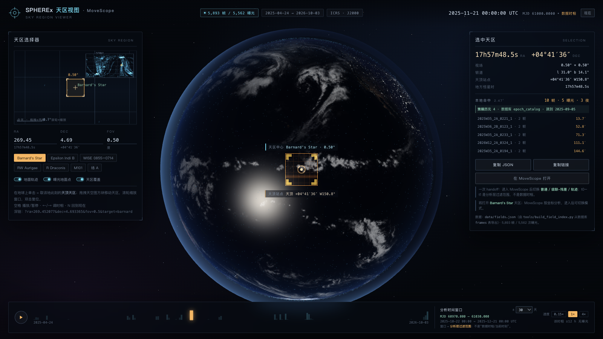

# SPHEREx 天区视图 · MoveScope（视图工具）

把数据库里的 **5,893 帧 / 5,562 次 SPHEREx 曝光**变成一颗可转动的三维地球和一个天区选择器：
在地球上点一下，就知道此刻那块天在谁的头顶；反过来，在天图上圈一块天区，地球会标出"该天区正上方"的站点，
并用真实曝光索引回答"**本地**拍过没有、拍了几帧几夜"。



---

## 1. 运行

```bash
cd 系统/视图工具
./start.sh            # 默认 http://127.0.0.1:8830/
./start.sh 8831       # 换端口
```

- 端口固定 **8830**（MoveScope 8790、数据库 8797），**不自动扫端口**；被占用时直接报错退出。
- 页面用 ES module + `fetch`，必须走 HTTP；直接双击 `index.html` 会被浏览器拦掉。
- 无构建、无网络依赖：three.js 与地球纹理都在 `vendor/`、`assets/`。
- 需要 WebGL2；不支持时页面会明确提示"浏览器不支持 WebGL2"，而不是让你去启动服务。

## 2. 深链契约（T1）

```text
http://127.0.0.1:8830/?ra=269.452077&dec=4.693365&fov=0.5&target=barnard
http://127.0.0.1:8830/?target=epsind_b          # 只给目标，用预设坐标
http://127.0.0.1:8830/?ra=120.5&dec=12.25&fov=0.4&t=61300.2
http://127.0.0.1:8830/?ra=269.452077&dec=4.693365&fov=0.5&target=barnard&t=61000&t0=60970&t1=61030
```

| 参数 | 含义 | 缺省 |
|---|---|---|
| `ra` / `dec` | 天区中心（度，ICRS） | 巴纳德星 |
| `fov` | 视场（度，0.05–180） | 3.5（默认）/ 目标预设 |
| `target` | 目标 id（`barnard`、`epsind_b`、`wise0855`、`rw_aur`、`r_dra`、`m101`、`campo_a`） | — |
| `t` | 数据时相 / 当前时刻（MJD） | 本地索引最后一次曝光 |
| `t0` / `t1` | 分析时间窗口起止（MJD，由当前时相 ±N 天得到） | `t ± 365` |

- **解析顺序**：`location.search` 优先，`location.hash` 兜底（旧的 `#ra=…` 链接仍可用）。
- 任何参数非法/缺失都回退默认，不抛错。
- 页面状态会以 `history.replaceState` **写回 search**（含 `target`、`t`、`t0/t1`），所以"复制链接"一定可复现。
- `t0/t1` 是**分析层过滤范围**，不是 `t` 这个“数据时相/当前时刻”；见 §3.5。

## 3. 在 MoveScope 打开（T2）

**唯一分析入口**是“在 MoveScope 打开”，一次 handoff 打开：

```text
http://127.0.0.1:8790/?ra=<当前 RA>&dec=<当前 Dec>&fov=<当前 FOV>&t0=<MJD>&t1=<MJD>&from=view
```

- 使用当前 **全精度** `ra/dec/fov`；不传 `target`，不传 `mode`。MoveScope 默认进入普通模式。
- `t0/t1` 是分析层过滤窗口（见 §3.5），不是当前数据时相。
- 进入 MoveScope 后，用户在同一画布切换 **普通 / 级联-残差 / 轨迹**；View 不再提供独立级联/轨迹页面入口。
- **探活**：`GET /api/health`（`mode:'no-cors'`）；不启动 MoveScope 就复制链接并提示"先 `app/server.py`"，不会假装打开。
- **地址**：`MOVESCOPE_ORIGIN` 默认 `http://127.0.0.1:8790`；可在页面加载前用 `window.MOVESCOPE_ORIGIN` 覆盖（联调/换端口时不必改源码）。
- **未命中预设**：MoveScope 仍按当前坐标分析；有真实历元则 REAL，否则 SIM。View 不伪造数据模式。

实测（2026-11-15 06:20，MoveScope :8790，本次单 handoff URL `ra=269.452077&dec=4.693365&fov=0.5&t0=60970&t1=61030&from=view`）：MoveScope 徽章 **REAL 真实**、**L2 就绪度**、**4 期**；MoveScope 自身会把 `target=custom` 追加到它的地址栏，但 View 发出的必需参数不变。

## 3.5 分析时间窗口与一次 handoff

底部时间条新增 **分析时间窗口 ±N 天**：

- 选项 **30 / 90 / 180 / 365 / 730**，默认 **365**。
- 始终以当前 `state.mjd` 为中心：`t0 = t − N`、`t1 = t + N`；拖时间轴、播放、点“现在”都会重算。
- 显示 **MJD t0–t1** 与 **UTC 起止**；页面状态写回 `t0/t1`，刷新可复现。
- 文案明确：**时间窗口 = 分析层过滤范围，不是“数据时相/当前时刻”**。`t` 决定播放/区域位置，`t0/t1` 随一次 handoff 发送。
- View 只有一个分析入口；进入 MoveScope 后再切换 **普通 / 级联-残差 / 轨迹**。旧的独立分析页保留为诊断页，但不再从 View 直达，也不存在隐藏按钮。

一次 handoff 示例（Barnard，±30 天，t=61000）：

```text
http://127.0.0.1:8790/?ra=269.452077&dec=4.693365&fov=0.5&t0=60970.0000&t1=61030.0000&from=view
```

- 点击前先 GET `/api/health` 探活；连不上时 toast 明确提示、复制链接，不静默失败。
- 分析页的 FOV 上限是 **3.0°**；当前 FOV 超过 3° 时，提示要求先调小（链接仍按当前 FOV 发送，避免伪装参数）。
- View 负责把 `ra/dec/fov/t0/t1/from=view` 送达；进入 MoveScope 后的模式切换与窗口消费由 MoveScope 负责，本工具不改 app。

## 4. "本地命中"口径（T5）

**2.47°** = 单片 3.49° 方视场的半对角线。中心落在 2.47° 内，才算"这帧拍到了该天区"。
统计拆三层：

| 指标 | 含义 |
|---|---|
| **帧** | 满足条件的探测器帧数（一行 = 一个探测器） |
| **曝光** | 不同 `obsid` 数（一个 obsid = 一次曝光，最多 6 帧） |
| **夜** | 不同 UTC 日期数 |

按这个口径（本地索引内）：

| 目标 | 帧 | 曝光 | 夜 | 最近中心距 |
|---|---|---|---|---|
| Barnard's Star | 10 | 5 | 3 | 13.7′ |
| Epsilon Indi B | 27 | 14 | 7 | 28.1′ |
| WISE 0855 | 26 | 12 | 6 | 56.3′ |
| RW Aurigae | 8 | 7 | 3 | 110.6′ |
| R Draconis | 11 | 8 | 6 | 49.3′ |
| M101 | 10 | 5 | 2 | 68.7′ |
| 场 A | 9 | 5 | 4 | 0.1′ |

> 快照：2026-11-15 00:10 CET，数据库 `frames` 5,893 行 / 5,562 次曝光 / 23 个观测周；本表由 `tools/smoke.py` 按 `fields.json` 与 2.47° 口径复核。

- 0 命中时显示"本地索引在 2.47° 内无命中"，并说明**本地只是 23 个观测周的子集**，不写成"没被拍过"。
- 命中目标时额外显示 **策展历元**（数据库 `target_epochs` 去重后的曝光数：Barnard 4、Eps Ind 10、RW Aur 1），点一下直接跳到该历元的时刻。

## 5. 数据来源与重建（T3/T4）

```
系统/数据库工具/var/catalog.sqlite : frames        ──build_field_index.py──▶  系统/视图工具/data/fields.json
系统/app/data/targets.json                          ──sync_targets.py──────▶  系统/视图工具/data/targets.json
系统/数据库工具/var/exports/epoch_catalog.json      ──sync_targets.py──────▶  系统/视图工具/data/epoch_index.json
```

```bash
# 重建曝光索引（默认读数据库；已存在则拒绝，加 --force 覆盖）
python3 tools/build_field_index.py --check     # 只比对
python3 tools/build_field_index.py --force

# 从 DB 导出物重建到临时文件（验证不依赖 header_cache / 已删除目录）
python3 tools/build_field_index.py --source export --out /tmp/fields.json --force

# 重建目标表 + 策展历元（单一源：app/data/targets.json）
python3 tools/sync_targets.py --check
python3 tools/sync_targets.py
```

- `fields.json` 不再依赖已删除的 `app/data/header_cache`；`--source export|db|headers` 可选，默认 `db`。
- `--out` 支持绝对路径或相对路径（相对当前工作目录）；默认 `data/fields.json`，已存在时拒绝覆盖，需加 `--force`。
- 数据快照随数据库变化：重建后行数会跟着 `frames` 表走（当前 5,893 帧 / 5,562 曝光），`--check` 一旦失败说明源变了，重跑即可。
- 输出带 `generated_by / source / source_sha256 / generated_at / count / exposures`。
- `data/targets.json` 是脚本生成的副本（含 `coord_unc_arcsec`，`rw_aur.truth` = 12.0 d / 0.85 mag），**不再手工维护第二份**。
- 重建结果与数据库逐行一致（`--check` 退出码 0）；`--source export` 与 `db` 当前逐行相同。

## 6. 自检

```bash
python3 tools/smoke.py
```

一条命令检查：DOM id、fields 行数/来源与数据库一致、targets/epoch_index 与单一源一致、交接契约
（`MOVESCOPE_ORIGIN` 默认 8790 + GET + 全精度 `ra/dec/fov` + `t0/t1` + `from=view`，不传 `mode/target`）、
分析时间窗口（30/90/180/365/730 + `t0/t1` + 以 `t` 为中心）、只有 MoveScope 一个分析入口、
“进入 MoveScope 后切换普通/级联/轨迹”文案、2.47° 覆盖表与 README 一致（RW Aurigae 非 0）、
`fields` 可由 DB/export 重建、文案不含旧项目名/旧端口/过时提示、`node --check`、`start.sh` 端口。
全部通过退出码 0。

## 7. 边界

1. **不做 FITS 渲染**：多期图像/闪烁/相减是 MoveScope 的职责，这里只选天区。
2. **本地索引是子集**：5,893 帧只覆盖 23 个观测周（2025-04-24 → 2026-10-03），空缺不代表没有观测。
3. **自定义天区交给 MoveScope 判断**：按坐标分析，有真实历元则 REAL，否则 SIM；View 不伪造。
4. 命中判据是"中心距 ≤ 2.47°"，不是逐像素求交；对大倾角扫描带是保守估计。
5. 地球纹理 2048 px，2 倍屏近看会软。
6. **分析窗口的消费方是 MoveScope 模式栏**：View 只计算并传递 `t0/t1/from=view`；进入 MoveScope 后切换普通/级联/轨迹，由 MoveScope 决定窗口如何过滤。
7. **分析页 FOV 上限 3.0°**：View 允许更大的浏览视场；超过 3° 时提示会要求调小，否则 MoveScope 会拒绝。
8. **View 不提供独立级联/轨迹入口**：旧诊断页只保留在 MoveScope 侧，不从 View 直达，也没有隐藏按钮。

## 8. 文件结构

```
系统/视图工具/
├── index.html              单页
├── css/style.css           HUD 样式
├── js/
│   ├── main.js             状态、深链、交接、覆盖口径
│   ├── globe.js            three.js 地球
│   ├── skymap.js           天图选择器
│   └── astro.js            时间 / 坐标 / 太阳
├── data/
│   ├── fields.json         5,893 帧 / 5,562 曝光（生成物）
│   ├── targets.json        7 目标（生成物）
│   └── epoch_index.json    37 个策展历元（生成物）
├── tools/
│   ├── build_field_index.py
│   ├── sync_targets.py
│   └── smoke.py
├── docs/                   预览截图与交接修复报告
├── vendor/three.module.js
├── vendor/three.LICENSE     three.js MIT 全文
├── assets/earth_*.{jpg,png}
└── start.sh
```

## 9. 参考与许可

> 本工具原创代码/文档按 **Apache-2.0**；第三方材料逐项列在根目录
> `THIRD_PARTY_NOTICES.md`。以下只列本工具直接使用的部分。

- **three.js r160**（MIT）：`vendor/three.module.js` 是 r160 的 minified ESM build
  （sha256 `3e690ac7…`），文件头保留 `SPDX-License-Identifier: MIT`；
  完整 MIT 文本见 `vendor/three.LICENSE`。来源：
  <https://threejs.org/>、<https://github.com/mrdoob/three.js>。
- **地球纹理**：`assets/earth_atmos_2048.jpg`、`earth_specular_2048.jpg` 与 three.js r160
  `examples/textures/planets/` 原文件 sha256 相同；`earth_clouds_1024.png`、
  `earth_lights_2048.png` 像素与 r160 一致、仅 PNG 重新编码。
  它们经 three.js 仓库（MIT）分发；原始影像来源标注为
  **NASA Visible Earth / Blue Marble**（NASA 媒体条款）：
  <https://visibleearth.nasa.gov/collection/1484/blue-marble>、
  <https://www.nasa.gov/nasa-brand-center/images-and-media/>。
  NASA 不背书本项目。
- **SPHEREx 数据**：NASA/IPAC IRSA（QR3/DR1），
  <https://irsa.ipac.caltech.edu/Missions/spherex.html>；仅作本地索引/缓存/可视化。
- **视觉与交互参考**：[bilawalsidhu/gods-eye-view](https://github.com/bilawalsidhu/gods-eye-view)
  （Cesium + HUD）；**未复用其代码或数据**，本工具用 three.js 自绘、离线可用。
  交互范式还参考 WiseView（Backyard Worlds: Planet 9）<http://byw.tools/wiseview>。
- 字体使用系统字体栈，不下载/分发第三方字体；图标为 CSS/Unicode/自绘 SVG。
- NASA Space Apps 官方 Legal/FAQ：
  <https://www.spaceappschallenge.org/legal/>、<https://www.spaceappschallenge.org/faq/>。
